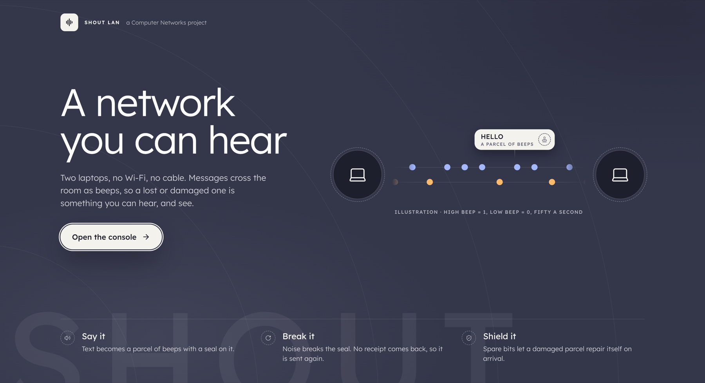
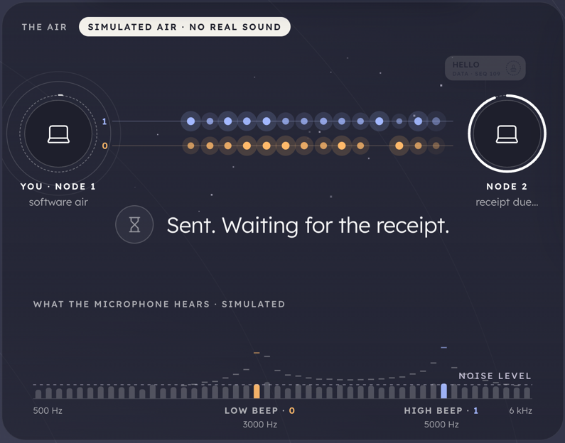
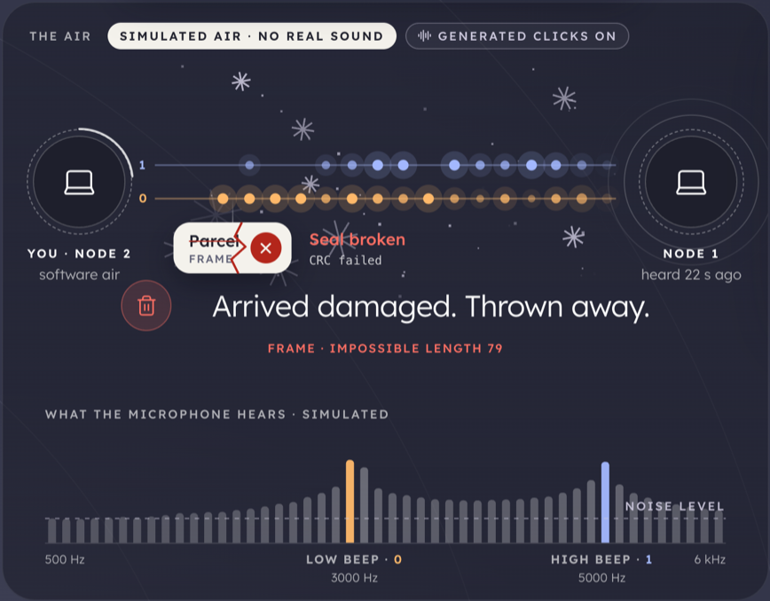
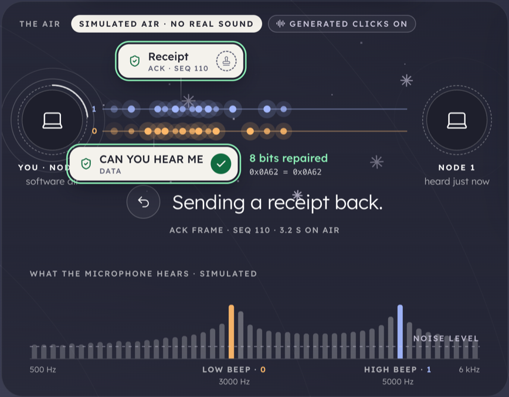
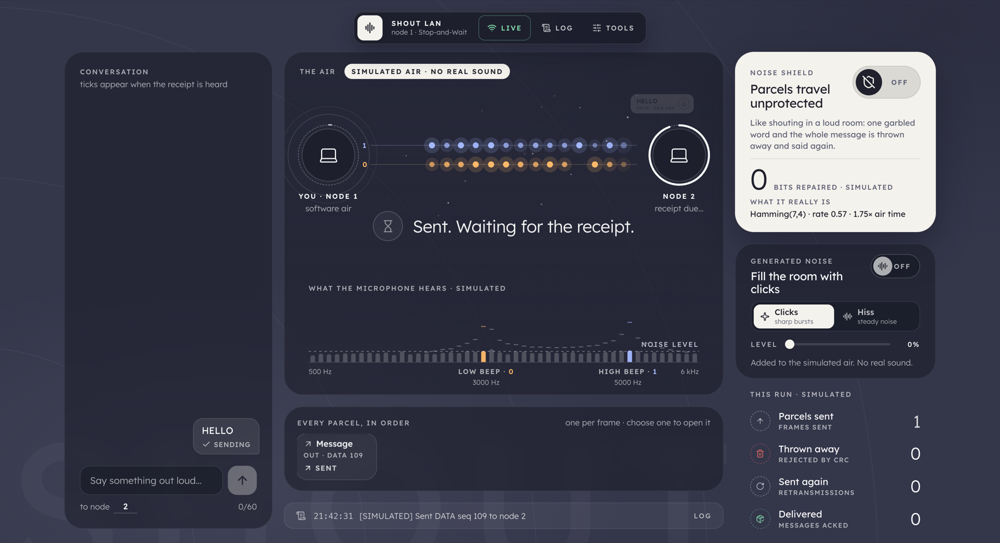
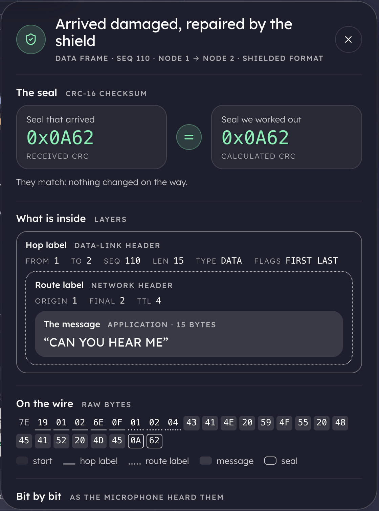
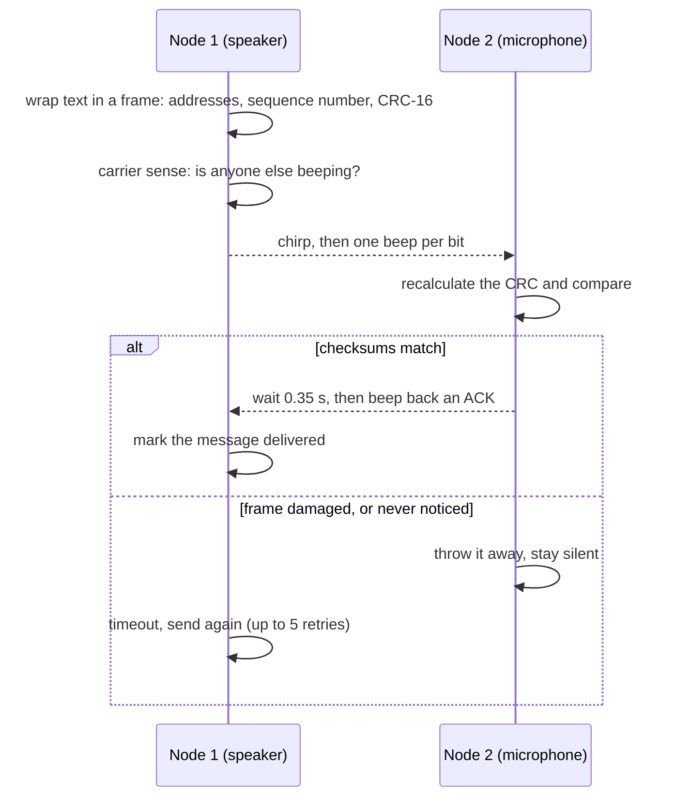
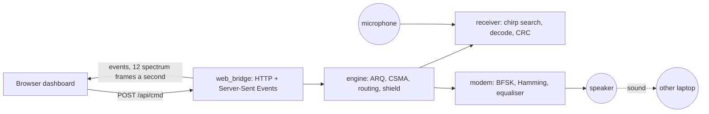

<p align="center">
  
</p>

<p align="center">
  
  
  
  
  
</p>

SHOUT LAN is a computer network whose only cable is the air in the room. Two laptops exchange messages as sound:
every bit is a short beep (3000 Hz for 0, 5000 Hz for 1, fifty a second) after a chirp that marks the start of a
frame. On top of that link runs a real protocol stack, so the things that are invisible on Wi-Fi (a corrupted
frame, a lost acknowledgement, a retransmission) can be heard in the room and watched on a dashboard.

## Try it in 30 seconds

No second laptop needed, and no sound:

```sh
python3 -m venv .venv && .venv/bin/python -m pip install -r requirements.txt
.venv/bin/python shout.py --node 1 --simulated
```

Two dashboards open, one per node. On node 1:

- **send a message**: a parcel crosses the stage, the receipt comes back, and only then does it say delivered;
- switch **Generated noise** on and send again: parcels arrive damaged, the checksum catches them, the sender tries again;
- switch **Noise Shield** on: the same noise, but the damaged bits are repaired and the message gets through.

For the real thing, on two laptops with everything wireless switched off, see [Run it for real](#run-it-for-real).

## What you get

<p align="center">
  
  
  
</p>
<p align="center">
  
  
</p>

- **The air:** what the microphone hears, live. Two lanes of beads, one per tone, and the spectrum underneath.
- **Parcels, seals and receipts:** a frame is a parcel, its CRC-16 is the seal, an acknowledgement is the receipt. Plain words first, the networking term beside them.
- **Every parcel, in order:** sent, intact, damaged, second try, repaired. Open any one to see its layers, its bytes and both checksum values.
- **Noise Shield:** one switch for forward error correction, with a count of the bits it repaired.
- **Generated noise:** clicks or hiss, really played through the speaker, so a demo is repeatable.
- **Nothing invented:** every number on screen comes from an engine event. The simulated mode says SIMULATED wherever it shows a measurement.

## How a message travels



A node never assumes success: it sends one frame and waits for its acknowledgement before the next (Stop-and-Wait).
If the acknowledgement is the one that gets lost, the receiver sees a sequence number it already has, does not
show the message twice, and acknowledges again.

## How it maps to the syllabus

| Topic | Where it lives | See it in the demo |
|---|---|---|
| Physical layer, digital modulation | [`shout_lan/modem.py`](shout_lan/modem.py): BFSK, chirp preamble, Goertzel tone detection | the two lanes of beads and the spectrum |
| Framing and addressing | [`shout_lan/frame.py`](shout_lan/frame.py) | open a parcel: hop label, route label, message |
| Error detection | [`shout_lan/crc.py`](shout_lan/crc.py): CRC-16-CCITT | "Seal broken", with received and calculated values |
| Error control | [`shout_lan/arq.py`](shout_lan/arq.py): Stop-and-Wait, Selective Repeat, adaptive timeout | the deadline ring, "2nd try" |
| Error correction | [`shout_lan/fec.py`](shout_lan/fec.py): Hamming(7,4) with interleaving | Noise Shield, "bits repaired" |
| Medium access | [`shout_lan/mac.py`](shout_lan/mac.py): CSMA, ALOHA | "channel busy, deferring" in the log |
| Equalisation | `Modem.demodulate_adaptive`: decision-feedback equaliser learned per frame | frames between two different laptops |
| Network layer | [`shout_lan/engine.py`](shout_lan/engine.py): discovery, routing table, relay with TTL | Tools: discover neighbours |
| Sockets, multithreaded server | [`shout_lan/web_bridge.py`](shout_lan/web_bridge.py), [`shout_lan/control_server.py`](shout_lan/control_server.py) | the dashboard itself |
| Security | [`shout_lan/security.py`](shout_lan/security.py): AES-256-GCM, [`docs/THREAT_MODEL.md`](docs/THREAT_MODEL.md) | |

## Measured between two laptops

A MacBook (node 1) and a Windows laptop (node 2), 30-50 cm apart in a quiet room, 18 November 2026. Full record,
including everything that went wrong on the way: [docs/TESTING.md](docs/TESTING.md).

| Test | Result |
|---|---|
| Windows to Mac, plain frames | 5 of 5 decoded |
| Mac to Windows, 5 plain messages, no noise | 5 delivered: 3 first try, 2 after a resend |
| Clicks on, Noise Shield **off**, 3 messages | 1 delivered, on its last try; 18 transmissions |
| Clicks on, Noise Shield **on**, 4 messages | 3 delivered, 2 of them first try; 9 transmissions, 10 bits repaired |

**Why the tones are 3000 and 5000 Hz.** The first tones, 2500 and 3500 Hz, lost half their frames in one
direction: the Windows speaker keeps ringing at 3500 Hz, so that tone never switched off at the Mac's microphone.
[`tools/tone_trial.py`](tools/tone_trial.py) tries six pairs between the two laptops, one a minute:

| Tones | Mac hearing Windows | Windows hearing Mac |
|---|---|---|
| **3000 / 5000 Hz** | 6 of 6 | 6 of 6 |
| 3250 / 4000 Hz | 6 of 6 | 6 of 6 |
| 1750 / 2750 Hz | 11 of 11 | 11 of 12 |
| 2750 / 4000 Hz | 5 of 5 | 4 of 6 |
| 2500 / 3500 Hz (before) | 3 of 6 | 5 of 5 |

**What is not proven.** These are small samples from one room and one placement of the laptops. Mac to Windows is
the weaker direction and loses about one plain frame in three. The right tones depend on the two laptops and where
they stand, so a new room may need the trial again.

## Noise Shield, and its limits

With the shield off, one flipped bit fails the checksum and the whole frame is sent again. With it on, every 4
data bits travel with 3 check bits (Hamming(7,4)), interleaved so that a short burst of noise damages at most one
bit in each block, and the receiver repairs it. A different start chirp announces a shielded frame, so receivers
decode both kinds with no setting, and a node answers in the format it was spoken to.

It costs airtime: a shielded frame is about 1.75 times as long. And it has limits: it repairs one bit in seven, so
it handles clicks and short bursts. Strong steady noise, or noise that hides the start chirp, still beats it, and
then the frame is resent as before.

## Run it for real

Two laptops, Wi-Fi and Bluetooth off.

| | |
|---|---|
| **Mac (node 1)** | double-click `start_mac.command` |
| **Windows (node 2)** | double-click `start_windows.bat` |

Each starts the engine on that laptop and opens its dashboard. Nothing needs a network: the dashboard is served
from the laptop to its own browser, and the web app is committed pre-built in `web/dist/`.

Before sending: close every other program that plays sound, set the volume and leave it, and put the laptops
30-50 cm apart with their speakers facing each other. The walk-through, with what to say and what to do when
something fails, is [docs/DEMO_SCRIPT.md](docs/DEMO_SCRIPT.md).

```sh
python shout.py --node 1 --peer 2       # real sound: this laptop's speaker and microphone
python shout.py --node 1 --pair         # one laptop: nodes 1 and 2 share its speaker and mic (real sound)
python shout.py --node 1 --simulated    # no sound: nodes 1 and 2 on a simulated air
```

Options: `--http PORT`, `--port PORT`, `--mic N`, `--speaker N`, `--shared`, `--volume V`, `--f0 HZ`, `--f1 HZ`,
`--key FILE`, `--no-browser`. Python 3.13. On Windows the engine opens the sound card in WASAPI exclusive mode,
because the normal shared mode runs noise suppression that removes the beeps.

## Architecture



One process per laptop hosts the engine and the dashboard server. The engine's threads talk through queues: the
audio callback only copies samples, a receiver thread finds and decodes frames, a transmit thread owns the
speaker, and each browser tab gets its own bounded event queue so a slow tab never blocks the link. The contract
between the engine and the web app is [docs/DASHBOARD_API.md](docs/DASHBOARD_API.md).

## Tests

```sh
python -m pytest -q          # silent: unit, protocol, simulated air, fake audio, web bridge
```

The tools under `tools/` play sound: `loopback_test.py`, `frame_test.py`, `arq_test.py`, `shield_test.py`,
`tone_trial.py`.

## Repository layout

```
shout.py                   launcher: engine + dashboard server
start_mac.command  start_windows.bat
shout_lan/                 config, modem, fec, audio_io, channel, receiver, frame, crc, arq, mac, engine,
                           control_server, web_bridge, node, security, stats, calibration, aloha_sim
web/                       the dashboard (React + TypeScript); built output in web/dist/
tools/                     sound tests, tone trial, key generator
tests/                     pytest suite
ns2/                       NS-2 topology script and AWK analysis (separate simulation module, not run)
docs/                      DEMO_SCRIPT, DASHBOARD_API, TESTING, ARCHITECTURE, SYLLABUS_MAPPING, THREAT_MODEL
results/                   saved measurements
```

## Team

Built for the Computer Networks course by [Zimran](https://github.com/ZimZam07) and [Anmol Agarwal](https://github.com/iAnmolAgarwal).
